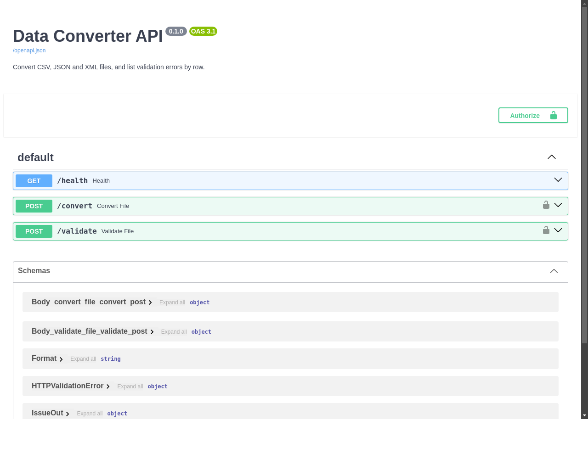
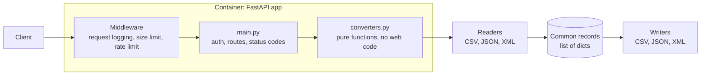

# Data Converter API

[](https://github.com/Nijada11/data-converter-api/actions/workflows/ci.yml)

A REST API that converts uploaded CSV, JSON and XML files between formats and lists validation errors by row.

**Live demo:** _not deployed yet_ <!-- Replace with https://<your-app>.azurecontainerapps.io/docs -->



## Features

- Converts between CSV, JSON and XML in any direction
- Handles messy real-world files: UTF-8, Latin-1, Windows-1252 and UTF-16 input, semicolon-delimited German Excel exports, quoted commas, and nested XML and JSON
- Reports every invalid row at once instead of stopping at the first
- API key authentication, 10 MB upload limit, rate limiting and JSON logs
- Blocks XML entity attacks (XXE and "billion laughs") by parsing with `defusedxml`

## Endpoints

| Method | Path | Purpose | Auth |
| --- | --- | --- | --- |
| `POST` | `/convert?from=csv&to=json` | Upload a file, get it back converted | `X-API-Key` |
| `POST` | `/validate` | Upload a file, get a list of errors with row numbers | `X-API-Key` |
| `GET` | `/health` | Monitoring check, returns `{"status": "ok"}` | None |
| `GET` | `/docs` | Interactive documentation | None |

`/validate` takes the format from the file extension, or from `?format=csv|json|xml`.

```console
$ curl -H "X-API-Key: $API_KEY" -F file=@samples/broken.csv localhost:8000/validate
{
  "valid": false,
  "format": "csv",
  "rows": 1,
  "errors": [
    {"row": 3, "message": "Found 2 column(s), expected 3."},
    {"row": 4, "message": "Found 4 column(s), expected 3."}
  ]
}
```

`row` is the line in the file, so you can jump straight to it in an editor. For items of a JSON array it is the item's position, starting at 1. It is `null` when the problem concerns the whole file.

### Status codes

| Code | Meaning |
| --- | --- |
| 200 | Converted, or a validation report was produced (even if the file is invalid) |
| 400 | Empty, binary or syntactically invalid file; `/validate` format unknown |
| 401 | Missing or invalid API key |
| 413 | File larger than the limit |
| 422 | File has invalid rows, or the request parameters are invalid |
| 429 | Rate limit exceeded |

### How data is converted

- **CSV values stay strings.** Guessing types would turn the postcode `01067` into `1067`.
- **Nested data becomes dotted columns.** `{"addr": {"city": "Bonn"}}` becomes a CSV column `addr.city`, and lists become `tags.0`, `tags.1`.
- **XML attributes become `@name` keys,** and text beside attributes or child elements becomes `#text`. These map back to attributes and text when writing XML.
- **Column names are made XML-safe.** `First Name` becomes `<First_Name>`.
- **Invalid files are refused, not partly converted,** so rows never go missing silently.

Known limits:

- Attributes on an XML root that wraps a list of records are dropped.
- XML namespaces are stripped.
- Control characters that XML 1.0 cannot represent are removed from XML output.
- CSV to JSON keeps dotted headers as literal names, so a JSON to CSV to JSON round trip does not restore nesting.

## Architecture



Every format is read into the same record list and written back from it, so adding a format means one reader and one writer rather than a converter for every pair. `/validate` and `/convert` share the same reader, so they cannot disagree about whether a file is valid.

## Run locally

Requires Python 3.12.

```bash
python -m venv .venv
source .venv/bin/activate
pip install -r requirements-dev.txt

export API_KEY=$(python -c "import secrets; print(secrets.token_urlsafe(32))")
echo "$API_KEY"
uvicorn src.main:create_app --factory --port 8000
```

Open <http://localhost:8000/docs>, click **Authorize**, and paste the key.

The server refuses to start without `API_KEY`. See [.env.example](.env.example) for the optional settings.

### Docker

```bash
docker build -t data-converter-api .
docker run -p 8000:8000 -e API_KEY=choose-a-key data-converter-api
```

### Tests and linting

```bash
pytest
ruff check .
```

The test run fails if coverage drops below 80%.

## Deployment

The API runs on Azure Container Apps. See the [deployment guide](docs/azure-deployment.md).

The rate limit is counted in memory, per replica, so the deployment is capped at one replica. Running more would need a shared store such as Redis.

## Licence

[MIT](LICENSE)
